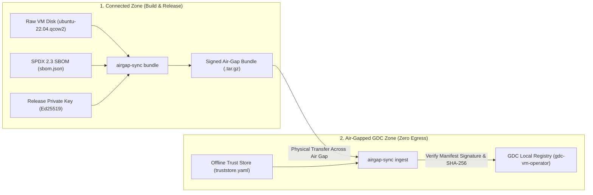

# GDC Air-Gap Sync (`gdc-airgap-sync`)

[](https://golang.org)
[]()
[]()
[]()
[]()

A secure **Cryptographic Provenance, Software Supply-Chain & Offline Ingestion CLI in Go**, designed to bridge the air-gap boundary for **Google Distributed Cloud (GDC)**.

Companion project to [**`gdc-vm-operator`**](https://github.com/uday68/gdc-vm-operator).

---

## 1. Architecture: Crossing the Air Gap



---

## 2. Security Invariants & Core Features

* **Verification-Before-Extraction:** The archive enforces `manifest.yaml` as the first entry. The controller reads and verifies the Ed25519 asymmetric signature **before** extracting any artifact bytes to disk, guaranteeing zero disk contamination from untrusted or tampered packages.
* **Offline Trust Store (`truststore.yaml`):** Implements cryptographic key management without internet connectivity. Tracks Ed25519 public key fingerprints (`KeyID`), signer identity, scope (`all`, `os-images`), and revocation status with mandatory audit reasons.
* **Truthful Provenance & SBOM Binding:** Eliminates hardcoded or fabricated release metadata. Manifests accurately capture build origin, release IDs, and cryptographically bind the SHA-256 digest of attached SPDX 2.3 / CycloneDX SBOM files.
* **Reproducible Packaging:** Generates byte-for-byte identical archives from the same inputs by normalizing timestamps, tar header ownership (0:0 UID/GID), permissions (`0644`), and gzip operating system flags (`255`).
* **Streaming Integrity Checks:** Computes SHA-256 digests via `io.MultiWriter` concurrently during extraction with $O(1)$ constant memory overhead, bounded by `io.LimitReader` to defend against decompression bombs.
* **Atomic Promotion to Registry:** Staged artifacts and `catalog.yaml` are published via temporary files and safe atomic rename operations, guaranteeing that failed or interrupted ingestions never leave corrupted or partial state in the `gdc-vm-operator` registry.

---

## 3. Quickstart

### Step 1: Build the CLI
```bash
go build -o bin/airgap-sync.exe ./cmd/airgap-sync
```

### Step 2: Generate Release Signing Keypair (Connected Zone)
```bash
.\bin\airgap-sync.exe keygen --out-dir ./keys
```
Outputs:
* `keys/release-private.pem` (Ed25519 private key, stored in secure HSM / CI)
* `keys/release-public.pem` (Ed25519 public key, transferred to offline cluster)

### Step 3: Package & Sign an OS Image (Connected Zone)
```bash
.\bin\airgap-sync.exe bundle \
  --name rhel-9 \
  --file rhel-9.qcow2 \
  --key ./keys/release-private.pem \
  --signer releng@cloud-supply-chain.org \
  --origin connected-releng-ci \
  --release-id v9.4 \
  --demo-fixture \
  --out ./dist/rhel-9.bundle.tar.gz
```

### Step 4: Setup Offline Trust Store (Air-Gapped Zone)
```bash
.\bin\airgap-sync.exe truststore init --out ./truststore.yaml
.\bin\airgap-sync.exe truststore add \
  --store ./truststore.yaml \
  --pubkey ./keys/release-public.pem \
  --identity releng@cloud-supply-chain.org \
  --scope os-images
.\bin\airgap-sync.exe truststore list --store ./truststore.yaml
```

### Step 5: Inspect and Verify the Bundle
```bash
.\bin\airgap-sync.exe inspect --bundle ./dist/rhel-9.bundle.tar.gz
.\bin\airgap-sync.exe verify \
  --bundle ./dist/rhel-9.bundle.tar.gz \
  --truststore ./truststore.yaml
```

### Step 6: Ingest into GDC Virtual Machine Operator Registry
```bash
.\bin\airgap-sync.exe ingest \
  --bundle ./dist/rhel-9.bundle.tar.gz \
  --truststore ./truststore.yaml \
  --registry-dir ../gdc-vm-operator/data/registry
```

---

## 4. Test Suite & Verification

```bash
# Run unit tests across all packages
go test -v ./...

# Run static analysis
go vet ./...

# Run end-to-end cross-repository integration test
go test -v ./test/e2e

# Run fuzz testing
go test -fuzz=FuzzParseManifest -fuzztime=5s ./pkg/manifest
go test -fuzz=FuzzIngestArchive -fuzztime=5s ./pkg/ingest
```

For interview talking points and architectural deep dives, consult the [Interview Study Guide](docs/INTERVIEW_STUDY_GUIDE.md).
