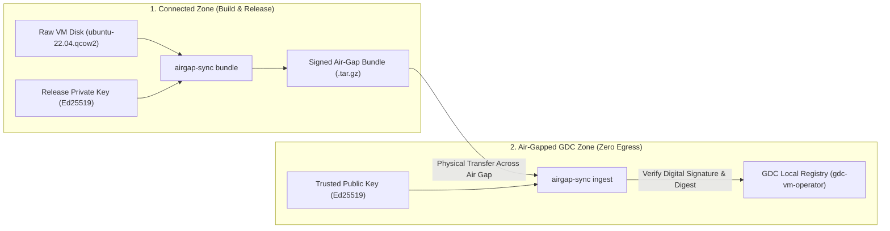

# GDC Air-Gap Sync (`gdc-airgap-sync`)

[](https://golang.org)
[]()
[]()
[]()

A secure **Cryptographic Provenance, Software Supply-Chain & Offline Ingestion CLI in Go**, designed to bridge the air-gap boundary for **Google Distributed Cloud (GDC)**.

Companion project to [**`gdc-vm-operator`**](https://github.com/uday68/gdc-vm-operator).

---

## 1. Architecture: Crossing the Air Gap



---

## 2. Features

* **Asymmetric Digital Signatures:** Generates and verifies cryptographic signatures with modern **Ed25519** public-key cryptography.
* **SPDX Software Bill of Materials (SBOM):** Embeds package inventories for supply-chain compliance and vulnerability audits.
* **Streaming Integrity Checks:** Computes SHA-256 digests via `io.MultiWriter` in $O(1)$ constant memory during decompression.
* **Zero-Trust Ingestion:** Rejects any tampered or unverified artifacts before promoting them to `gdc-vm-operator`'s local catalog.

---

## 3. Quickstart

### Step 1: Generate Signing Keypair
```bash
go build -o bin/airgap-sync.exe ./cmd/airgap-sync
.\bin\airgap-sync.exe keygen --out-dir ./keys
```

### Step 2: Package & Sign an OS Image (Connected Zone)
```bash
.\bin\airgap-sync.exe bundle \
  --name rhel-9 \
  --file rhel-9.qcow2 \
  --key ./keys/release-private.pem \
  --out ./dist/rhel-9.bundle.tar.gz
```

### Step 3: Inspect the Release Bundle
```bash
.\bin\airgap-sync.exe inspect --bundle ./dist/rhel-9.bundle.tar.gz
```

### Step 4: Verify Digital Signature
```bash
.\bin\airgap-sync.exe verify \
  --bundle ./dist/rhel-9.bundle.tar.gz \
  --pubkey ./keys/release-public.pem
```

### Step 5: Ingest into GDC Virtual Machine Operator
```bash
.\bin\airgap-sync.exe ingest \
  --bundle ./dist/rhel-9.bundle.tar.gz \
  --pubkey ./keys/release-public.pem \
  --registry-dir ../gdc-vm-operator/data/registry
```

---

## 4. Test Suite

```bash
go test -v ./...
```
* **Coverage:** Keypair serialization/deserialization, signing, verification, tamper-detection, tarball bundling, and end-to-end promotion into the GDC operator registry.

For technical deep dive and Google interview talking points, consult the [Interview Study Guide](docs/INTERVIEW_STUDY_GUIDE.md).
